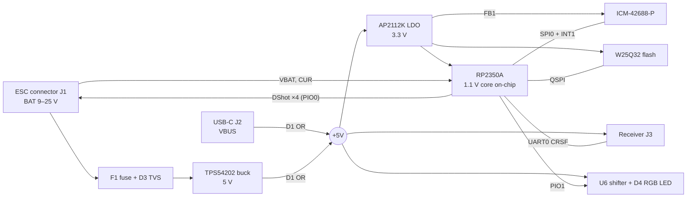

# SNB-HW-001: Snowboard Flight Controller Hardware Specification

| Field | Value |
| --- | --- |
| Document ID | SNB-HW-001 |
| RFC | 0001 |
| Board | Snowboard (KiCad project `snowboard_fc`) |
| Hardware revision | Rev 3 |
| Document version | 1.1 |
| Status | Released. Describes Rev 3 as ordered. |
| Date | 2026-10-16 |
| Owner | Rotem Carr |

## 1. Scope

This document specifies the Snowboard Rev 3 flight controller: an RP2350A-based board that replaces the flight controller in a SpeedyBee F405 V4 stack, drives the stack's 4-in-1 ESC, and runs Zephyr firmware.

The KiCad schematic (`hardware/snowboard_fc.kicad_sch`) is the authoritative source. Where this document and the schematic disagree, the schematic governs and this document is in error. Changes after Rev 3 are recorded in new RFCs, not in this document.

## 2. References

| ID | Document |
| --- | --- |
| [R1] | Raspberry Pi Ltd, *Hardware design with RP2350* (RP-008280-DS), build 2024-10-15 |
| [R2] | Raspberry Pi Ltd, RP2350 Datasheet |
| [R3] | Raspberry Pi Ltd, RP2350A Minimal design, KiCad files, R4 |
| [R4] | TDK InvenSense, ICM-42688-P Datasheet, DS-000347 |
| [R5] | Texas Instruments, TPS54202 Datasheet |
| [R6] | XINGLIGHT, XL-1615RGBC-WS2812B Datasheet |
| [R7] | Betaflight board documentation, SPEEDYBEEF405V4 |

## 3. System overview

| Item | Specification |
| --- | --- |
| MCU | RP2350A, QFN-60, 2× Cortex-M33 at 150 MHz |
| Clock | 12 MHz crystal, Abracon ABM8-272-T3 |
| Program flash | 4 MB QSPI, W25Q32JVSNIQ |
| IMU | ICM-42688-P on SPI, INT1 to GPIO |
| Input voltage | 3S to 6S LiPo (9.0 to 25.2 V) via the ESC connector |
| Rails | 5 V buck (TPS54202), 3.3 V LDO (AP2112K-3.3), 1.1 V on-chip core regulator |
| Motor outputs | 4× DShot via PIO, 8-pin ESC connector |
| RC input | CRSF over UART0, 4-pin connector |
| Sensing | Battery voltage and ESC current on ADC |
| Indicators | Blue status LED, 1× addressable RGB LED |
| Host interfaces | USB-C (USB 2.0 full speed, UF2 boot), SWD |
| Board | 40 × 40 mm, 30.5 × 30.5 mm mounting pattern |
| PCB | 4 layers, 1.0 mm, ENIG |

*Figure 1. Power tree and signal paths.*

Battery voltage enters only through the ESC connector. All signals between devices use 3.3 V logic, except the RGB LED data line, which is shifted to 5 V.

## 4. Power

### 4.1 Input

| Parameter | Value |
| --- | --- |
| Source | J1 pin 2 (BAT), from the ESC |
| Range | 9.0 to 25.2 V (3S to 6S) |
| Fuse | F1, TLC F12F1, 1 A fast, 32 V, 1206 |
| Transient clamp | D3, SMBJ26A |
| Bulk capacitance | 2× 10 µF 50 V X7R 1210, plus 100 nF |

### 4.2 5 V rail

| Parameter | Value |
| --- | --- |
| Regulator | U3, TPS54202DDCR, SOT-23-6 |
| Inductor | L1, YNR4018-100M, 10 µH, 1.3 A |
| Output capacitance | 2× 22 µF 10 V X7R 0805 |
| Feedback divider | 100 kΩ / 13.3 kΩ, 1 %; output 5.08 V nominal |
| Enable divider | 100 kΩ / 20 kΩ; turn-on threshold approximately 7 V |
| Bootstrap | 100 nF |
| Loads | Receiver (J3), RGB LED and level shifter, 3.3 V LDO |

USB VBUS is diode-ORed onto the 5 V rail through D1 (BAT54C), so the board runs from USB alone for flashing and bring-up.

### 4.3 3.3 V rail

| Parameter | Value |
| --- | --- |
| Regulator | U4, AP2112K-3.3TRG1, SOT-25, 600 mA |
| Capacitance | 1 µF input, 1 µF output |
| Loads | RP2350A IOVDD, QSPI_IOVDD, USB_OTP_VDD, ADC_AVDD and VREG_VIN; flash; IMU (filtered, see 6.1) |

### 4.4 1.1 V core rail

The RP2350A's internal switching regulator generates DVDD. Its circuit and layout are copied without modification from [R3], as [R1] section 2.1 requires.

| Ref | Part | Function |
| --- | --- | --- |
| L2 | Abracon AOTA-B201610S3R3-101-T, 3.3 µH, 0806 | Regulator inductor, polarity dot toward +1V1 |
| C5 | 4.7 µF 0402 | VREG_VIN input |
| C1 | 4.7 µF 0402 | Regulator output |
| R1, C4 | 33 Ω, 4.7 µF 0402 | VREG_AVDD RC filter |
| — | 100 nF 0402, one per pin | DVDD, IOVDD, QSPI_IOVDD, USB_OTP_VDD, ADC_AVDD decoupling |

## 5. RP2350A support circuits

### 5.1 Crystal

Y1 is an Abracon ABM8-272-T3, 12 MHz, 10 pF load, with 15 pF C0G load capacitors (C18, C19) and a 1 kΩ series resistor on XOUT (R3), per [R1] chapter 4. This circuit is tuned for IOVDD = 3.3 V and requires re-validation at any other IOVDD.

### 5.2 Flash and boot

| Item | Implementation |
| --- | --- |
| Flash | U2, W25Q32JVSNIQ, 4 MB, SOIC-8 150 mil, on QSPI |
| Chip-select pull-up | R2, 10 kΩ to 3.3 V, fitted (recommended by [R1] for parts other than W25Q128) |
| BOOTSEL | SW1, C&K PTS810SJM250SMTRLFS, to QSPI_SS through R5, 1 kΩ |
| Reset | RUN pulled up through 10 kΩ, 100 nF to GND, test pad |

### 5.3 USB

| Item | Implementation |
| --- | --- |
| Connector | J2, GCT USB4085-GF-A, USB-C, through-hole |
| Series termination | R14, R15, 27 Ω, inside the reference core block |
| CC | 5.1 kΩ to GND on CC1 and CC2 (UFP) |
| ESD | D5, USBLC6-2SC6 |
| Shield | 1 MΩ in parallel with 4.7 nF to GND |

### 5.4 Debug

J4 is a JST SM03B-SRSS-TB, pinout SWCLK, GND, SWDIO, matching the Raspberry Pi Debug Probe cable.

## 6. Peripherals

### 6.1 IMU

| Item | Implementation |
| --- | --- |
| Device | U5, ICM-42688-P, LGA-14, 2.5 × 3.0 mm |
| Interface | 4-wire SPI; 33 Ω series on SCK at the MCU |
| Supply | VDD and VDDIO from 3.3 V through FB1 (Murata BLM18KG601SN1D, 600 Ω at 100 MHz) |
| Decoupling | 2.2 µF and 100 nF on VDD, 10 nF on VDDIO, per [R4] Table 11 |
| Interrupts | INT1 to GPIO6. No external pull-up; firmware configures INT1 push-pull. INT2/FSYNC (pin 9) tied to GND. |
| Reserved pins | Pin 7 to GND; pins 2, 3, 10, 11 to GND |
| Clock | Internal oscillator |

### 6.2 ESC interface

J1 is a JST SM08B-SRSS-TB. The pin order copies the SpeedyBee F405 V4 flight controller so the stock 1:1 cable fits unchanged [R7].

| J1 pin | Signal | Circuit | ESC side |
| --- | --- | --- | --- |
| 1 | GND | Ground plane | GND |
| 2 | BAT | F1 to buck input; divider 100 kΩ / 10 kΩ (÷11) with 100 nF to GPIO26 | VBAT |
| 3 | M1 | GPIO8, 100 Ω series | S1 |
| 4 | M2 | GPIO9, 100 Ω series | S2 |
| 5 | M3 | GPIO10, 100 Ω series | S3 |
| 6 | M4 | GPIO11, 100 Ω series | S4 |
| 7 | CUR | 10 kΩ series, 100 nF to GND, D6 (BAT54S) clamp to 3.3 V, to GPIO27 | CURRENT |
| 8 | TEL | 1 kΩ series to GPIO22 | not connected |

Motor outputs are 3.3 V logic, which the BLHeli_S ESC accepts. The ESC current output is 40 mV/A, so 55 A corresponds to 2.2 V at the ADC.

### 6.3 RC receiver interface

J3 is a JST SM04B-SRSS-TB, connected to the Happymodel EP2 receiver through a 4-pin pigtail.

| J3 pin | Signal | Circuit |
| --- | --- | --- |
| 1 | 5 V | 5 V rail, 100 nF local |
| 2 | GND | Ground plane |
| 3 | FC_TX | GPIO0 (UART0 TX), 100 Ω series, to receiver RX |
| 4 | FC_RX | GPIO1 (UART0 RX), 100 Ω series, from receiver TX |

### 6.4 Indicators

| Item | Implementation |
| --- | --- |
| Status LED | D2, blue, 0603, GPIO17 through 1 kΩ, active high |
| Level shifter | U6, 74AHCT1G125GW, 5 V supply, input from GPIO16 through 100 Ω, OE to GND |
| RGB LED | D4, XINGLIGHT XL-1615RGBC-WS2812B, 1.6 × 1.5 mm, 5 V, 100 nF; DIN from U6 through 330 Ω |
| RGB LED pinout | 1 GND, 2 DIN, 3 VDD, 4 DOUT |
| Expansion | DOUT to a 3-pad group (5 V, DOUT, GND) for an external LED strip |

D4 protocol: single wire, GRB order, 800 kbit/s, reset low time of at least 300 µs.

### 6.5 Spare I/O

| Function | GPIO | Implementation |
| --- | --- | --- |
| Aux UART (PIO) | 12 (TX), 13 (RX) | Pads with 5 V and GND |
| I2C1 | 14 (SDA), 15 (SCL) | Pads with 3.3 V and GND; 4.7 kΩ pull-ups |
| Buzzer | 18 | Q1 (2N7002) low-side driver; BZ+ on 5 V, flyback diode |
| RSSI | 28 (ADC2) | Pad, 10 kΩ series |

## 7. Pin assignment

| GPIO | Net | Peripheral | Dir | Reference |
| --- | --- | --- | --- | --- |
| 0 | RX_TX | UART0 TX | out | 6.3 |
| 1 | RX_RX | UART0 RX | in | 6.3 |
| 2 | IMU_SCK | SPI0 SCK | out | 6.1 |
| 3 | IMU_MOSI | SPI0 TX | out | 6.1 |
| 4 | IMU_MISO | SPI0 RX | in | 6.1 |
| 5 | IMU_CS | GPIO | out | 6.1 |
| 6 | IMU_INT1 | GPIO interrupt | in | 6.1 |
| 7 | — | not connected | — | — |
| 8 | M1 | PIO0 SM0 | out | 6.2 |
| 9 | M2 | PIO0 SM1 | out | 6.2 |
| 10 | M3 | PIO0 SM2 | out | 6.2 |
| 11 | M4 | PIO0 SM3 | out | 6.2 |
| 12 | AUX_TX | PIO UART TX | out | 6.5 |
| 13 | AUX_RX | PIO UART RX | in | 6.5 |
| 14 | I2C_SDA | I2C1 SDA | bidir | 6.5 |
| 15 | I2C_SCL | I2C1 SCL | out | 6.5 |
| 16 | WS_DATA | PIO1 SM0 | out | 6.4 |
| 17 | STATUS_LED | GPIO | out | 6.4 |
| 18 | BUZZ | GPIO | out | 6.5 |
| 19–21 | — | not connected | — | — |
| 22 | ESC_TEL | PIO UART RX | in | 6.2 |
| 23–25 | — | not connected | — | — |
| 26 | VBAT_SENSE | ADC0 | in | 6.2 |
| 27 | CUR_SENSE | ADC1 | in | 6.2 |
| 28 | RSSI | ADC2 | in | 6.5 |
| 29 | — | not connected | — | — |

Motor outputs occupy consecutive GPIOs so one PIO block drives all four. ADC inputs are restricted to GPIO26–29 on the RP2350A. Erratum E9 applies to all inputs: internal pull-downs are not used.

GPIO12 and GPIO13 offer only UART0, which the receiver already uses on GPIO0/1, and GPIO22 offers only UART1 TX. The auxiliary UART and ESC telemetry therefore use PIO UARTs; see L-07.

## 8. Connectors

| Ref | Part | LCSC | Function | Mating part |
| --- | --- | --- | --- | --- |
| J1 | JST SM08B-SRSS-TB | C160407 | ESC | SpeedyBee 8-pin cable, 1:1 |
| J2 | GCT USB4085-GF-A | — | USB-C | Any USB-C data cable |
| J3 | JST SM04B-SRSS-TB | C160404 | RC receiver | 4-pin SH pigtail, 1:1 |
| J4 | JST SM03B-SRSS-TB | C160403 | SWD | Raspberry Pi Debug Probe cable |

All JST connectors are SH 1.0 mm, side entry, opening facing the board edge. The battery (XT30) and motors connect to the ESC, not to this board.

## 9. Mechanical and PCB

| Parameter | Value |
| --- | --- |
| Outline | 40 × 40 mm |
| Mounting | 4× Ø4 mm on 30.5 × 30.5 mm, for M3 grommets |
| Stackup | JLCPCB JLC04161H-7628, 4 layers, 1.0 mm; In1 solid GND |
| Finish | ENIG |
| Minimum trace/space | 0.127 mm |
| Vias | 0.45 mm pad, 0.25 mm drill; none in SMD pads except the RP2350 exposed-pad vias from [R3] |
| Power traces | 0.5 mm, including the buck switch node |
| Silkscreen | "Snowboard Rev. 3", snowflake mark, forward arrow, pin-1 marks |

The RP2350 core block (U1 with its regulator, crystal, decoupling and USB termination) is a pad-for-pad copy of [R3]: 114 pads, 89 tracks, 22 vias and 8 zones, with no foreign copper inside its zones. The flash sits to the left of the core block because [R3]'s flash position is used by J2.

Deviation from [R3]: [R3] is a 2-layer 1.6 mm board; Snowboard is 4-layer 1.0 mm, and the core block's ground vias land on the In1 plane.

## 10. Key components

Passives not listed are generic 0402 and 0603 parts. The complete list is the JLC BOM in `hardware/fab/rev3/`.

| Ref | Part | LCSC | Note |
| --- | --- | --- | --- |
| U1 | RP2350A | — | QFN-60 |
| U2 | W25Q32JVSNIQ | — | 4 MB flash |
| U3 | TPS54202DDCR | — | 5 V buck |
| U4 | AP2112K-3.3TRG1 | — | 3.3 V LDO |
| U5 | ICM-42688-P | — | IMU |
| U6 | 74AHCT1G125GW | — | Level shifter |
| Y1 | ABM8-272-T3 | C20625731 | 12 MHz crystal |
| L1 | YNR4018-100M | — | Buck inductor |
| L2 | AOTA-B201610S3R3-101-T | C42411119 | Core regulator inductor |
| FB1 | BLM18KG601SN1D | — | IMU supply filter |
| F1 | TLC F12F1 | C2924985 | Input fuse |
| D4 | XL-1615RGBC-WS2812B | C5349954 | RGB LED |
| SW1 | PTS810SJM250SMTRLFS | — | BOOTSEL |
| C18, C19 | 15 pF C0G 0402 | C1548 | Crystal load |
| C1, C4, C5 | 4.7 µF 10 V X5R 0402 | C23733 | Core regulator |

## 11. Manufacturing

The board is fabricated and fully assembled by JLCPCB, including the through-hole USB-C connector. No hand assembly is required.

| File | Content |
| --- | --- |
| `snowboard_fc_gerbers_jlc.zip` | Gerbers and drill files |
| `snowboard_fc_JLC_BOM_v7.csv` | Assembly BOM |
| `snowboard_fc_JLC_CPL_v5.csv` | Placement file |

J2 and SW1 are sourced through JLC Global Sourcing. L2 and Y1 may require pre-order.

Before releasing an assembly order, verify in the placement preview: U1 pin-1 mark; L2 polarity dot toward +1V1; D4 pin-1 mark; J1, J3 and J4 openings facing the board edge; J2 seated over its holes.

Rev 3 design checks: KiCad DRC reports 0 violations, 0 unconnected items and 0 footprint errors; all 341 pads match the schematic netlist.

## 12. Bring-up and verification

Tests run in order, with no battery and no ESC until T-04, so a power fault cannot reach the motors.

| ID | Test | Pass criteria |
| --- | --- | --- |
| T-01 | Continuity, unpowered | No shorts between BAT, 5 V, 3.3 V, 1.1 V and GND; J1 pin 1 is GND, pin 2 isolated from GND |
| T-02 | USB power | Enumerates as RP2350 BOOTSEL mass storage; 3.3 V and 1.1 V within tolerance; status LED blinks under Zephyr `blinky` |
| T-03 | SWD | Debug Probe attaches on J4; `west flash` and `west debug` succeed |
| T-04 | 12 V on J1 pin 2, 200 mA limit | 5 V rail 5.00–5.15 V, ripple below 50 mV; rail off below approximately 7 V |
| T-05 | IMU | WHO_AM_I reads 0x47; INT1 asserts at the configured rate; gyro noise at rest below 0.1 dps rms per axis |
| T-06 | ADC | VBAT_SENSE reads input ÷ 11 within 2 %; CUR_SENSE reads 0 V with no ESC |
| T-07 | Indicators and UART | D2 and D4 respond; UART0 loops back through a jumper on J3 |
| T-08 | Motors, props removed, 4S | DShot frames arm the ESC; each motor spins on command; M1–M4 order matches Betaflight convention; CUR tracks a known load |
| T-09 | Receiver | CRSF frames parse; channels track the sticks; failsafe triggers within 1 s of transmitter off |

## 13. Known limitations and errata

| ID | Item | Effect | Mitigation |
| --- | --- | --- | --- |
| L-01 | RP2350 erratum E9, GPIO pull-down leakage | Inputs relying on internal pull-downs can read high | No internal pull-downs used |
| L-02 | BLHeli_S on the ESC | No bidirectional DShot, so no RPM filtering | Flash Bluejay on the ESC; 100 Ω series resistors already permit bidirectional DShot |
| L-03 | DShot implemented in PIO | Timing errors make the ESC ignore frames | Verify bit timing on a scope before connecting the ESC |
| L-04 | Buck switching noise | Elevated gyro noise | FB1 and local decoupling at U5; verify with T-05 |
| L-05 | Ceramic antenna on the EP2 receiver | Reduced range inside a carbon frame | Mount the receiver with the antenna clear of the frame |
| L-06 | Core layout copied onto a different stackup | Regulator behaviour not characterised on 4-layer 1.0 mm | Verify 1.1 V stability under full CPU load during T-02 |
| L-07 | Aux UART (GPIO12/13) and ESC telemetry (GPIO22) are not on usable hardware UART pins | No hardware UART for these functions | PIO UARTs in firmware; next revision moves the aux UART to GPIO20/21 (UART1) |

Open items for the next revision are tracked in `hardware/README.md`.

## 14. Revision history

| Version | Date | Change |
| --- | --- | --- |
| 0.1 | 2026-10-11 | Initial prototype design |
| 1.0 | 2026-10-16 | Aligned with Rev 3 as ordered: core circuit and layout per [R3], ABM8-272-T3 crystal, AOTA inductor, VREG_AVDD filter, W25Q32JVSNIQ, XL-1615RGBC-WS2812B, 40 × 40 mm outline, full JLC assembly |
| 1.1 | 2026-10-16 | Pin assignment verified against the Rev 3 netlist; aux UART and ESC telemetry corrected to PIO UARTs (L-07) |
